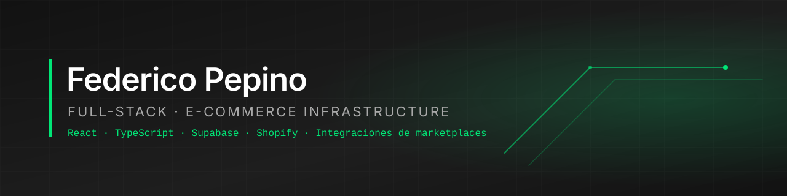

  

### Full-Stack & E-Commerce Infrastructure · Córdoba, Argentina 🇦🇷

Construyo **plataformas de e-commerce omnicanal**: vidrieras en React, temas de Shopify a medida, backends en Postgres y Edge Functions, e integraciones con marketplaces (Mercado Libre, Amazon, Mercado Pago). Me enfoco en datos consistentes entre canales, código validado y despliegues reproducibles con Git.

---

#### Frontend

#### Backend

#### DB / Cloud

#### E-Commerce e integraciones

---

### ◆ Proyecto principal: `cucuhome`, e-commerce omnicanal

> Shopify como fuente de verdad del catálogo y el checkout. Alrededor: una vidriera en React, un tema propio y un backend que sincroniza stock y pedidos con marketplaces de Argentina, Brasil y EE. UU.

| Capa | Qué resuelve | Stack |
|---|---|---|
| **Vidriera** | Catálogo en vivo, filtros por categoría y precio, paginación y estado en la URL | React 18 · TypeScript · Vite · Tailwind · TanStack Query |
| **Tema Shopify** | Tema OS 2.0 propio: 3 idiomas, filtros, carrito AJAX, requisitos legales de AR (precio sin impuestos, Botón de arrepentimiento). 0 errores en `theme check` | Liquid · CSS · JS sin dependencias |
| **Backend** | Cola de sincronización con `FOR UPDATE SKIP LOCKED`, OAuth + PKCE con Mercado Libre, webhooks que nunca confían en el body, tipo de cambio por hora, pedidos de Amazon con cursor incremental | Supabase · PostgreSQL · Deno · pg_cron · Vault |

**Repos:** [`cucuhome`](https://github.com/magicfede/cucuhome) · [`cucuhome-theme`](https://github.com/magicfede/cucuhome-theme) · [`portafolio`](https://github.com/magicfede/portafolio)

---

### ◆ Métricas

  
  

---

### ◆ Contacto

| | |
|---|---|
| 🌐 Portafolio | [github.com/magicfede/portafolio](https://github.com/magicfede/portafolio) |
| 📍 Ubicación | Córdoba, Argentina · remoto |
