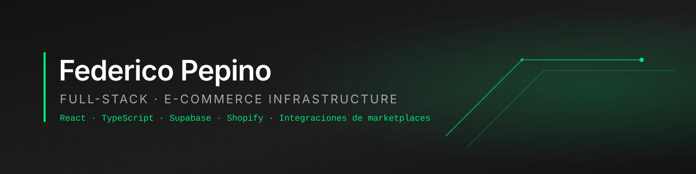

  

## Federico Andrés Pepino

**Desarrollador web full-stack y comunicador · Córdoba, Argentina 🇦🇷**
Ingeniería en Computación y Licenciatura en Historia (UNC).

Hago dos cosas que se cruzan: **medios digitales por sector** (portales de noticias, datos y contactos para el agro, la minería, la energía y la lechería) y **comercio electrónico omnicanal** (Shopify, marketplaces y backends propios). Trabajo con una regla fija: datos reales con su fuente, nada inventado, y todo el código versionado y publicado de forma reproducible.

---

### 📰 Portales sectoriales: medios digitales del interior productivo

Portales con noticias del sector actualizadas solas tres veces por día, cotizaciones, mapa de proyectos, foro, directorio de contactos verificados y espacio para anunciantes. Todos salen de un **motor común**: cada portal es una carpeta de configuración (nombre, fuentes, colores, contactos) sobre el mismo código.

| Portal | Sector | En línea |
|---|---|---|
| **El Gran Ganadero** | Hacienda, remates y mercados del agro | [el-gran-ganadero.pages.dev](https://el-gran-ganadero.pages.dev) |
| **El Gran Minero** | Minería argentina, de norte a sur | [el-gran-minero.pages.dev](https://el-gran-minero.pages.dev) |
| **El Gran Energético** | Petróleo, gas y minería | [el-gran-energetico.pages.dev](https://el-gran-energetico.pages.dev) |
| **La Cuenca Láctea** | Lechería (Suardi, Santa Fe) | [la-cuenca-lactea.pages.dev](https://la-cuenca-lactea.pages.dev) |

**Cómo está hecho:** React + TypeScript + Vite · Cloudflare Pages + Functions + D1 (foro) · GitHub Actions para la carga automática de noticias y cotizaciones · fotos con licencia libre y crédito.

**Repositorios:** `portales-sectoriales` (motor común) · `el-gran-ganadero` · `el-gran-minero` · `el-gran-energetico` · `la-cuenca-lactea`

---

### 🛒 Cucumber Home: e-commerce omnicanal

Shopify como fuente de verdad del catálogo y el checkout. Alrededor: una vidriera en React, un tema propio y un backend que sincroniza stock y pedidos con marketplaces de Argentina, Brasil y EE. UU.

| Capa | Qué resuelve | Stack |
|---|---|---|
| **Tema Shopify** | Tema OS 2.0 propio: 3 idiomas, filtros, carrito AJAX, requisitos legales de AR (precio sin impuestos, botón de arrepentimiento) | Liquid · CSS · JS sin dependencias |
| **Vidriera** | Catálogo en vivo, filtros por categoría y precio, estado en la URL | React 18 · TypeScript · Vite · Tailwind · TanStack Query |
| **Backend** | Cola de sincronización, OAuth + PKCE con Mercado Libre, webhooks verificados, tipo de cambio por hora, pedidos de Amazon | Supabase · PostgreSQL · Deno · pg_cron · Vault |

**Repositorios:** `cucuhome` · `cucuhome-theme` · `portafolio` (índice, arquitectura e investigación de mercado)

---

### 🗂️ CRM y bases de datos

| Proyecto | Qué es |
|---|---|
| [`ConstructoraPepino`](https://github.com/magicfede/ConstructoraPepino) | Esquema de CRM multiempresa en PostgreSQL: clientes, planes de ahorro, presupuestos y analítica mensual, con datos de ejemplo |

---

### 🧰 Herramientas

---

### 📌 Cómo trabajo

- **Datos con fuente.** Cada noticia, precio o contacto lleva de dónde salió; si no está verificado, queda en blanco.
- **Respeto por los derechos.** Las notas enlazan al medio original y las fotos son de licencia libre, con crédito.
- **Todo en Git.** Cada cambio queda registrado y cada sitio se publica desde su repositorio.

> La mayoría de los repositorios son privados. Si querés ver el código de alguno, escribime por GitHub.
